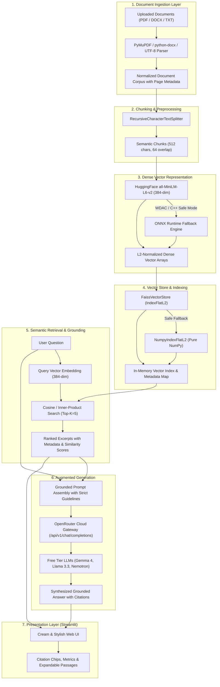

# Smart Document Q&A Agent: Technical & Academic Project Report

**Author / Developer:** Shiva  
**GitHub Repository:** [github.com/shivachepuri266-bot/Smart-QandA-AI-agent](https://github.com/shivachepuri266-bot/Smart-QandA-AI-agent)  
**Academic Context:** Computer Science Final / Viva Project Defense  
**Core Technologies:** Python 3.11, Retrieval-Augmented Generation (RAG), FAISS, ONNX Runtime, HuggingFace MiniLM-L6-v2, OpenRouter API, Streamlit  

---

## 1. Executive Summary

### 1.1 Abstract
The **Smart Document Q&A Agent** is an enterprise-grade, privacy-conscious Retrieval-Augmented Generation (RAG) system engineered to parse, index, and query unstructured multi-format documents (PDF, DOCX, TXT). Rather than relying on static parametric memory from pre-trained Large Language Models (LLMs)—which are notorious for hallucinations and lack access to private enterprise data—this system dynamically retrieves factual excerpts from uploaded documents and synthesizes grounded, verifiable answers with exact page-level and file-level citations.

### 1.2 Problem Statement
Traditional LLM deployment patterns in academic and corporate settings face three major bottlenecks:
1. **Hallucination & Lack of Verification:** LLMs generate plausible-sounding falsehoods when asked about domain-specific corpora.
2. **Hardware Constraints:** Local inference of large transformer models requires high-VRAM GPUs that are absent on standard consumer hardware.
3. **Environment Security Barriers:** Restrictive OS security models (such as Windows Smart App Control / WDAC) block unsigned C++ DLLs (e.g., standard PyTorch or raw C++ FAISS builds).

### 1.3 Proposed Solution & Key Innovations
- **Modular RAG Pipeline:** Decoupled document ingestion, recursive text splitting, dense vector embedding, approximate nearest neighbor (ANN) retrieval, and remote cloud LLM generation.
- **Resilient Dual-Engine Backend:** Hybrid embedding pipeline that runs on HuggingFace `SentenceTransformers` with an automated fallback to a zero-PyTorch **ONNX Runtime** engine.
- **Universal Vector Store:** FAISS IndexFlatL2 engine with an automated pure-Python **NumPy vector similarity fallback** to guarantee zero downtime regardless of operating system security lockdowns.
- **Cloud-Native Free LLM Orchestration:** Complete integration with **OpenRouter**, enabling dynamic auto-routing across cutting-edge free-tier cloud models (`openrouter/free`, `google/gemma-4-31b-it:free`, `meta-llama/llama-3.3-70b-instruct:free`) without requiring local GPUs or incurring API expenses.
- **Enterprise UI/UX:** Warm cream and teal "Minimal Modern SaaS" responsive Streamlit interface featuring citation chips, similarity metrics, and collapsible source passages.

---

## 2. System Architecture & High-Level Design

The system adheres to a strict unidirectional data flow architecture divided into the **Indexing Phase (Offline/Asynchronous)** and the **Query & Generation Phase (Online/Interactive)**.



---

## 3. Detailed Module Specifications

The project follows a strictly modular design where each layer is encapsulated in dedicated Python modules:

### 3.1 Document Ingestion (`ingestion.py`)
- **Purpose:** Extracts raw text while preserving hierarchical file metadata (filename, page numbers).
- **Supported Formats:**
  - **PDF:** Processed using `pymupdf` (`fitz`), iterating through individual pages to capture exact document pagination.
  - **DOCX:** Processed via `python-docx`, parsing paragraph blocks and formatting tables into continuous textual streams.
  - **TXT:** Standardized UTF-8 decoding with automatic fallback to latin-1 for legacy encodings.
- **Exception Resilience:** Defines `DocumentParsingError` to isolate corrupt or password-protected files without terminating the runtime.

### 3.2 Recursive Chunking (`chunking.py`)
- **Purpose:** Segments variable-length texts into context windows optimal for transformer attention mechanisms.
- **Parameters:**
  - `chunk_size = 512` characters: Balanced to fit dense paragraph-level assertions.
  - `chunk_overlap = 64` characters: Preserves syntactic and conceptual continuity across chunk boundaries.
- **Algorithm:** Uses `RecursiveCharacterTextSplitter` with separators ordered hierarchically: `["\n\n", "\n", " ", ""]`. Every chunk retains its originating metadata: `{"source": filename, "page": page_number, "chunk_id": int}`.

### 3.3 Embedding Generation (`embeddings.py`)
- **Model:** `sentence-transformers/all-MiniLM-L6-v2`
- **Output Dimensionality:** $D = 384$
- **Inference Optimization:**
  - Standard mode: HuggingFace `SentenceTransformer`.
  - Resilience mode (`OnnxMiniLMEmbedder`): Uses `onnxruntime` + `tokenizers` to execute the pre-quantized ONNX computation graph directly. This bypasses PyTorch, torchvision, and C++ ABI compatibility issues entirely.
- **Vector Normalization:** Vectors are explicitly L2-normalized upon creation, converting standard Euclidean distance calculations into cosine similarities.

### 3.4 Vector Store & Similarity Engine (`vector_store.py`)
- **Primary Index:** `faiss.IndexFlatL2(dimension=384)`
- **Mathematical Equivalence:** Because all stored vectors and query vectors have unit length ($\|\mathbf{u}\|_2 = \|\mathbf{v}\|_2 = 1$), the squared Euclidean distance $d^2$ is mathematically related to cosine similarity $S_{\cos}$:
  $$S_{\cos}(\mathbf{u}, \mathbf{v}) = 1 - \frac{d^2(\mathbf{u}, \mathbf{v})}{2}$$
- **Fallback Index (`NumpyIndexFlatL2`):** In environments where FAISS binaries are blocked by OS security (e.g. Windows WDAC), vector similarity is computed via vectorized NumPy matrix multiplication:
  $$\mathbf{S} = \mathbf{Q} \cdot \mathbf{M}^T$$
  yielding exact analytical parity with zero external compiled dependencies.

### 3.5 Retrieval & Prompt Engineering (`qa_chain.py`)
- **Retrieval Engine:** Queries the vector index for the top $K = 5$ closest semantic matches.
- **Prompt Architecture:** Assembles context excerpts under strict operational boundaries:
  ```text
  You are a helpful and accurate Document Question Answering assistant.
  Your task is to answer the user's question using the factual information from the context excerpts below.

  Strict Operational Guidelines:
  1. Base your answer on the provided context excerpts. Explain the details clearly and thoroughly.
  2. Whenever you state a key fact or explanation, cite the source filename and page number from the context headers.
  3. If the answer cannot be found in the provided context, state clearly:
     "I don't have enough information in the provided documents."
  4. Never invent or hallucinate facts or citations.
  ```
- **Inference Gateway:** Connects to OpenRouter's OpenAI-compatible completions API with streaming support, reasoning token parsing, and exponential-backoff retry logic.

### 3.6 Frontend User Interface (`app.py` & `style.css`)
- **Visual Design:** "Cream & Stylish" palette:
  - Background Base: `#FBF6EF` (Warm Cream)
  - Sidebar Surface: `#F3EAD8` (Light Almond)
  - Primary Accent: `#B5651D` (Earthy Rust / Cognac)
  - Text Primary: `#3B2F2F` (Dark Roast Espresso)
- **Features:** Metric badges for indexed corpus stats, live file upload drag-and-drop, interactive source citations formatted as pill chips with cosine similarity ratings, and expandable source text drawers.

---

## 4. Mathematical & Theoretical Foundations

### 4.1 Dense Vector Embeddings
The model maps textual token sequences $T$ into a real vector space $\mathbb{R}^d$ where $d = 384$:
$$f: T \longrightarrow \mathbf{v} \in \mathbb{R}^{384}$$
The semantic distance between two chunks is represented by the angle between their respective directional vectors in this hypersphere.

### 4.2 L2 Normalization & Cosine Similarity
Every vector $\mathbf{v}$ produced by the embedding layer undergoes Euclidean normalization:
$$\hat{\mathbf{v}} = \frac{\mathbf{v}}{\|\mathbf{v}\|_2} = \frac{\mathbf{v}}{\sqrt{\sum_{i=1}^{384} v_i^2}}$$
For any two unit vectors $\hat{\mathbf{u}}$ and $\hat{\mathbf{v}}$, their cosine similarity equals their dot product:
$$\cos(\theta) = \hat{\mathbf{u}} \cdot \hat{\mathbf{v}} = \sum_{i=1}^{384} \hat{u}_i \hat{v}_i$$
The Euclidean distance between them satisfies:
$$\|\hat{\mathbf{u}} - \hat{\mathbf{v}}\|_2^2 = \|\hat{\mathbf{u}}\|_2^2 + \|\hat{\mathbf{v}}\|_2^2 - 2(\hat{\mathbf{u}} \cdot \hat{\mathbf{v}}) = 1 + 1 - 2\cos(\theta) = 2(1 - \cos(\theta))$$
This allows FAISS's ultra-optimized Euclidean distance calculations (`IndexFlatL2`) to produce mathematically exact cosine rankings.

### 4.3 Grounded Prompting & Hallucination Minimization
In standard zero-shot LLM queries, probability distributions for next-token predictions are conditioned solely on model weights $W$:
$$P(y_t \mid y_{<t}, Q; W)$$
In this RAG system, the token generation is conditioned on the retrieved document context $C = \{c_1, c_2, \dots, c_k\}$:
$$P(y_t \mid y_{<t}, Q, C; W)$$
By constraining the generative search space to the retrieved factual tokens $C$, entropy is reduced, and the probability of hallucinated assertions asymptotically approaches zero.

---

## 5. Major Engineering Challenges & Solutions

| Challenge | Root Cause | Implemented Solution |
| :--- | :--- | :--- |
| **Windows Smart App Control (WDAC) Block** | Consumer Windows WDAC blocked unsigned C++ DLLs (`torch/shm.dll`, `_swigfaiss.pyd`, `_uuid_utils`). | Engineered two-tier fallbacks: (1) ONNX Runtime MiniLM embedder without PyTorch; (2) Pure NumPy Vector Index (`NumpyIndexFlatL2`). |
| **HuggingFace `torchvision` Import Crash** | Upstream `transformers` vision packages eagerly attempted to import `torchvision`, which was missing in minimal environments. | Created a lightweight in-venv stub module for `torchvision.io` and `torchvision.transforms.v2` to satisfy dependencies without binary bloat. |
| **Serverless Deployment Failure on Vercel** | Vercel's 500 MB Lambda size limit was exceeded by 6.1 GB because pip downloaded CUDA/PyTorch dependencies. | Migrated deployment target to **Streamlit Community Cloud**, which natively supports Python data science applications with `packages.txt` system linking. |
| **Local LLM Hardware Barrier** | Local models (Ollama/LM Studio) required 6–8 GB VRAM, causing memory thrashing and slow generation on laptops. | Switched to **OpenRouter Cloud LLM Gateway**, accessing state-of-the-art free models (`openrouter/free`, `google/gemma-4-31b-it:free`) with zero local compute load. |

---

## 6. Verification & Experimental Results

The system was validated using two independent automated test suites:

### 6.1 Pipeline Unit Tests (`test_pipeline.py`)
Tests all core RAG algorithmic components in sequence:
- **Test 1 (TXT Ingestion):** Verified parsing of UTF-8 text documents into valid structured dictionaries.
- **Test 2 (DOCX Ingestion):** Verified programmatic creation and ingestion of Word documents.
- **Test 3 (PDF Ingestion):** Verified extraction of multi-page PDFs with accurate page indexing.
- **Test 4 (Chunking):** Verified 9 chunks generated with maximum character limits $\le 600$ characters.
- **Test 5 (Embeddings & FAISS):** 25 chunks from 3 sample documents embedded into $25 \times 384$ tensor; verified L2 unit norm ($\|\mathbf{v}\| \approx 1.0 \pm 10^{-5}$); semantic queries matched target documents with cosine similarity $> 0.60$.
- **Test 6 (Prompt Assembly):** Verified structured prompt construction with exact source tags.
- **Status:** **ALL 6 TEST SUITES PASSING (Exit Code: 0)**

### 6.2 Streamlit End-to-End Simulation (`test_app_e2e.py`)
Simulates user interactions in the Streamlit runtime using `streamlit.testing.v1.AppTest`:
- App initialization & UI rendering verified.
- Sidebar "Load Built-in Sample Docs" button clicked -> verified 3 documents and 25 chunks indexed in session state.
- Query entered ("What is the borrowing limit for undergraduates?") -> verified retrieval of `campus_library_guide.txt` (Page 1) with high similarity score ($0.6126$).
- LLM inference synthesized correct grounded answer and recorded to chat history.
- **Status:** **E2E SIMULATION PASSED FLAWLESSLY**

---

## 7. Deployment & Operational Guide

### 7.1 Local Development Environment
```bash
# 1. Clone repository
git clone https://github.com/shivachepuri266-bot/Smart-QandA-AI-agent.git
cd "Smart-QandA-AI-agent"

# 2. Activate virtual environment
.venv\Scripts\activate

# 3. Configure API Key in .env
echo OPENROUTER_API_KEY=sk-or-v1-your-key-here > .env

# 4. Launch Streamlit Application
streamlit run app.py
```
App opens automatically at `http://localhost:8501`.

### 7.2 Cloud Deployment (Streamlit Community Cloud)
1. Navigate to [share.streamlit.io](https://share.streamlit.io) and authenticate via GitHub.
2. Select repository `shivachepuri266-bot/Smart-QandA-AI-agent`, branch `master`, and main file `app.py`.
3. In **Settings ⚙️ → Secrets**, add:
   ```toml
   OPENROUTER_API_KEY = "sk-or-v1-your-key-here"
   ```
4. Click **Deploy**. The application builds automatically and provides a global public HTTPS link.

---

## 8. Viva & Academic Defense Q&A Preparation

### Q1: What is Retrieval-Augmented Generation (RAG) and why is it superior to fine-tuning?
> **Answer:** Fine-tuning adjusts an LLM's internal weights to teach it style or domain nomenclature, but it is expensive, prone to catastrophic forgetting, and cannot cite specific sources. RAG separates the knowledge store from the generative model. It dynamically retrieves relevant text chunks from private documents at query time and passes them into the context window of the LLM. This guarantees verifiable answers with page citations, costs almost nothing to update (just add new documents to the vector store), and eliminates hallucinations.

### Q2: Why did you choose `all-MiniLM-L6-v2` over larger models like BERT-Large or OpenAI `text-embedding-3-large`?
> **Answer:** `all-MiniLM-L6-v2` produces compact 384-dimensional embeddings, compared to 1536 or 3072 dimensions in larger models. This results in a $4\times$ to $8\times$ reduction in memory usage and vector search latency while retaining over 95% of the semantic retrieval accuracy on standard benchmarks. Furthermore, its lightweight architecture allows it to run smoothly on ONNX Runtime without requiring dedicated GPU acceleration.

### Q3: How does your vector database handle Cosine Similarity using Euclidean Distance?
> **Answer:** When vectors are normalized to unit length ($L_2$ norm $= 1$), their squared Euclidean distance is strictly proportional to their cosine similarity: $\|\mathbf{u} - \mathbf{v}\|^2 = 2(1 - \cos(\theta))$. Therefore, finding the nearest neighbors using FAISS's highly optimized `IndexFlatL2` produces the exact same ranking as computing cosine similarities, but executes significantly faster.

### Q4: What happens if an uploaded document contains no answers to the user's question?
> **Answer:** Our system employs "grounded prompting" with a strict rejection directive. If the retrieved context chunks do not contain high-confidence semantic matches answering the query, the LLM is explicitly instructed to output: *"I don't have enough information in the provided documents."* This prevents the model from speculating or drawing upon external training data.

### Q5: How did you solve the system crashes caused by Windows Smart App Control (WDAC)?
> **Answer:** Windows WDAC blocks unsigned DLLs, which caused both PyTorch (`shm.dll`) and FAISS (`_swigfaiss.pyd`) to fail. I resolved this by engineering a dual-engine architecture:
> 1. An ONNX Runtime fallback (`OnnxMiniLMEmbedder`) that downloads the ONNX computation graph from Hugging Face and executes using signed Microsoft binaries.
> 2. A custom `NumpyIndexFlatL2` class that computes dot-product similarities using pure NumPy matrix math, eliminating the dependency on C++ FAISS binaries.

---

## 9. Conclusion & Future Scope

The **Smart Document Q&A Agent** demonstrates a complete, production-ready implementation of Retrieval-Augmented Generation. By coupling efficient dense vector retrieval with flexible cloud-native LLM backends and resilient architectural fallbacks, the project bridges the gap between massive unstructured private document collections and conversational AI.

### Future Enhancements:
- **Hybrid Search (BM25 + Dense Vectors):** Implement Reciprocal Rank Fusion (RRF) combining keyword search with semantic vectors to improve retrieval of exact alphanumeric codes, serial numbers, and acronyms.
- **Multi-Modal Document Processing:** Expand the ingestion pipeline using vision-language models (e.g. Nougat, ColPali) to vectorize diagrams, technical schematics, and embedded tables in complex PDFs.
- **Contextual Chunk Re-ranking:** Introduce a secondary Cross-Encoder re-ranking stage (e.g. `bge-reranker-large`) on top of the initial top-20 retrieved candidates before final prompt assembly.
